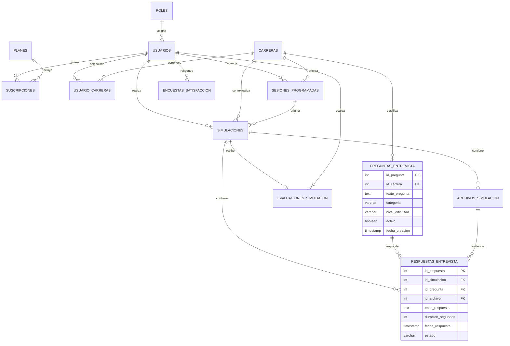

# Diagrama de base de datos JobReady

La ampliacion incorpora preguntas de entrevista y las respuestas realizadas dentro de cada simulacion.
Una pregunta puede ser general (`id_carrera` nulo) o estar dirigida a una carrera. Cada simulacion solo
puede contener una respuesta por pregunta. La respuesta puede guardar texto y asociarse a un archivo de
video o audio previamente registrado en `archivos_simulacion`.

## Reglas principales

- Una pregunta puede utilizarse en muchas simulaciones.
- Una simulacion puede responder muchas preguntas.
- No puede existir mas de una respuesta para la misma pregunta dentro de una simulacion.
- Las preguntas se desactivan en lugar de eliminarse para conservar el historial.
- Las respuestas se eliminan automaticamente si se elimina su simulacion.
- Si se elimina un archivo, la respuesta permanece y su referencia al archivo queda nula.
